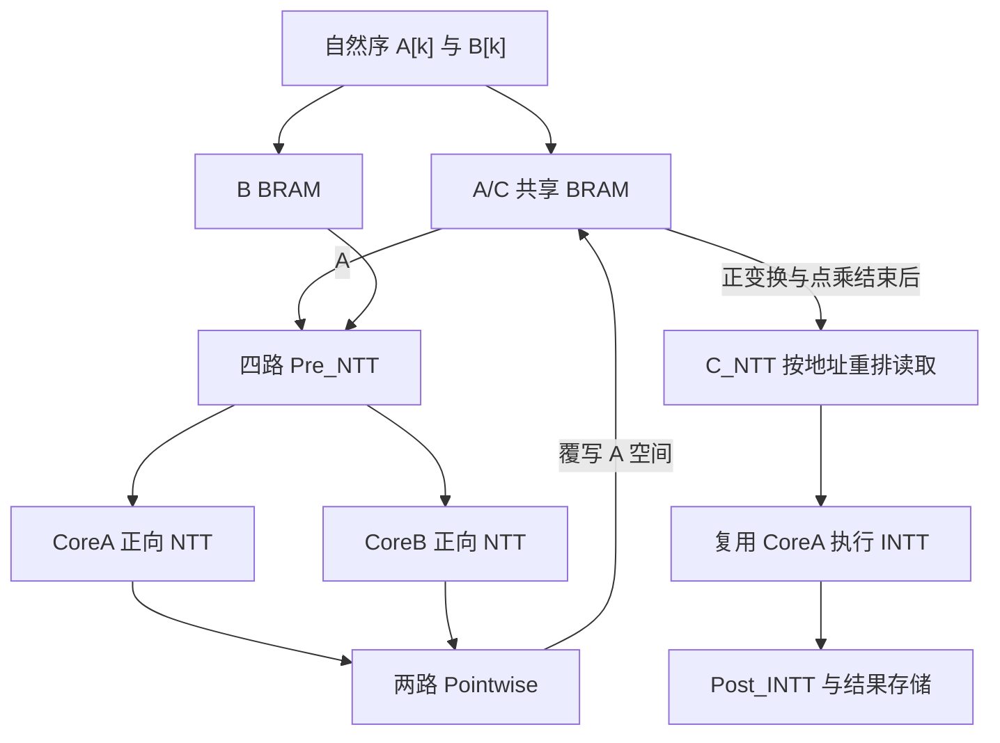

# MDC-NTT 数字硬件项目展示

面向数字 IC 验证、RTL 开发与 FPGA 岗位的硕士科研项目：4096 点、固定 60 位模数、64 位接口的负循环多项式乘法器。采用两个 2-path Radix-2 GS-MDC 核并行完成 A/B 的 NTT，逐点模乘后复用 CoreA 执行 INTT。

**先看这三处：** [生产顶层](rtl/poly_mul_top_dual_forward.sv) · [自然序输入自检测试台](sim/tb_poly_mul_top_dual_forward_natural_ab.sv) · [验证与性能证据](docs/portfolio/evidence.md)

## 版本入口

| 入口 | 用途 |
|---|---|
| [本展示分支 portfolio-2026-10-10](https://github.com/mzybest/MDC-NTT/tree/portfolio-2026-10-10) | 简历链接；从固定源码版本整理展示文档，不改 RTL |
| [源码快照 b608e020](https://github.com/mzybest/MDC-NTT/tree/b608e02036b2ce541eb94bc0f0c3e05abd8b612f) | 2026-10-10 核验的精确源码版本 |
| [开发分支](https://github.com/mzybest/MDC-NTT/tree/codex/q64-core-control-localization) | 原双核开发入口，后续可能继续变化 |
| [main](https://github.com/mzybest/MDC-NTT/tree/main) | 保留早期单核基线；不是双核实现 |

本页“生产实现”指 `rtl/` 中供工程集成的双核路径，不表示已流片、上板或完成板级签核。展示采用自然序输入、BRAM A/C 复用和共享外围模乘池的**显式参数配置**，不是直接使用顶层全部默认参数；[配置见此](docs/portfolio/architecture.md)。

## 实现价值

- **RTL 集成：** 双核锁步输出直接送入每拍 2 点的 Pointwise；CoreB 仅支持正变换，CoreA 保留双模式。
- **存储与控制：** C_NTT 覆写已结束读取的 A 输入 BRAM；通过读地址重排供给全 GS INTT；同步 BRAM 预取、valid 与地址标签保持对齐。
- **验证：** 自检 SystemVerilog 测试台、Python 参考结果、自然序装载气泡、定向负循环乘法、完整输出比对、存储所有权断言与周期检查。
- **FPGA 优化：** 分层延迟存储、局部 twiddle ROM、固定模数 Montgomery 约减及控制局部化；实验分别记录资源、时序和适用范围。

这些材料展示科研工程中的数据通路、验证与实现分析工作。它们不作为 UVM、ASIC 后端全流程、CDC 签核、覆盖率收敛或流片经历的证明。

## 架构概览

复用为分阶段调度：Pointwise 后完成 C_NTT 缓存，再启动逆变换；没有声称无缓存或四路逆变换已集成。

## 功能与结果边界

| 状态 | 内容 |
|---|---|
| 已有生产 RTL 与历史功能验证记录 | 双核 NTT、CoreA 复用 INTT、2 点/拍 Pointwise、自然序 A/B 装载、A/C BRAM 复用、读地址重排 |
| 本次重新执行通过 | Python NTT/INTT 往返、已提交 4096 点黄金向量校验、N=16 地址模型、4096 个 Post 因子与 10000 次等价检查 |
| 独立实验 | 固定四路 INTT 测试台；12 拍 CSA 与 Karatsuba 模乘快照；200 MHz 内部时序记录 |
| 未完成 | 生产双核运行时切换四路 INTT；Forward→4p INTT→Forward 完整集成；板级 IO 约束、上板计时与功耗测量 |

历史自然序配置记录为 **8623 拍 start-to-done**，连续加载加计算 **12719 拍**，均不含结果存储逐项读回。200 MHz/246 DSP 属于 Karatsuba 独立快照，不是生产默认指标。原始证据的公开完整程度及版本差异见 [证据索引](docs/portfolio/evidence.md)。

## 招聘阅读导航

| 阅读目标 | 入口 |
|---|---|
| 理解输入接口、存储生命周期与配置 | [架构简介](docs/portfolio/architecture.md) |
| 找到模块、参考模型、断言与回归 | [代码导航和复现](docs/portfolio/code_navigation.md) |
| 核验 PASS、周期与资源时序归属 | [验证与性能证据](docs/portfolio/evidence.md) |
| 核对简历措辞与版本 | [项目描述核对](docs/portfolio/resume_alignment.md) |

本展示仅新增文档和本次 Python 检查记录；源码、测试台、mem 与原历史结果保持原样。
